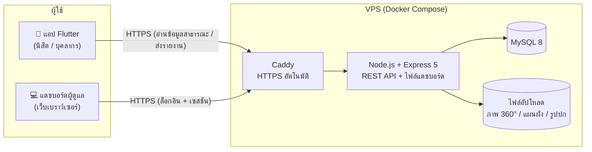
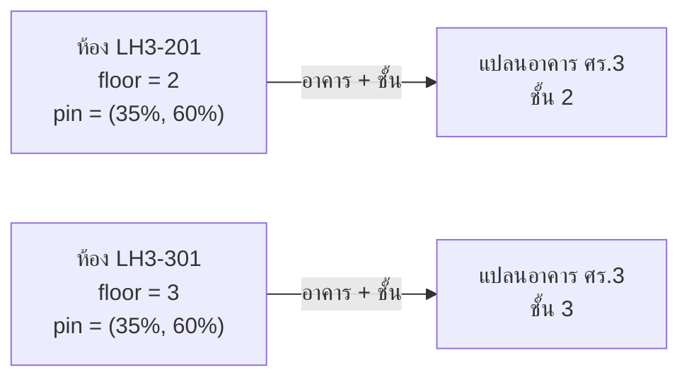

<div align="center">

# KPS ClassFinder

**ระบบค้นหาห้องเรียนและอาคารอัจฉริยะ — มหาวิทยาลัยเกษตรศาสตร์ วิทยาเขตกำแพงแสน**

แอปมือถือสำหรับนิสิตและบุคลากร พร้อมแดชบอร์ดผู้ดูแลระบบบนเว็บ
ค้นห้อง ดูตำแหน่งบนแผนผังชั้น ชมภาพ 360° และรู้ทันทีว่าห้องหรืออาคารเปิดอยู่หรือไม่


**เว็บไซต์ / แดชบอร์ด:** <https://kps-classfinder.tech>

**📲 [ดาวน์โหลดแอป Android (APK)](https://drive.google.com/drive/folders/1QaUFYkkwUnD-RSZK7tL0N0m-1K2xUZpi?usp=sharing)**

</div>

---

## สารบัญ

- [ผู้จัดทำ](#ผู้จัดทำ)
- [ดาวน์โหลดและติดตั้งแอป](#ดาวน์โหลดและติดตั้งแอป)
- [ภาพรวมของระบบ](#ภาพรวมของระบบ)
- [ระบบมีอะไรบ้าง](#ระบบมีอะไรบ้าง)
- [สถาปัตยกรรมและวิธีการทำงาน](#สถาปัตยกรรมและวิธีการทำงาน)
- [ระบบแยกชั้นอย่างไร](#ระบบแยกชั้นอย่างไร)
- [วิธีใช้งานแอป (สำหรับนิสิต/บุคลากร)](#วิธีใช้งานแอป-สำหรับนิสิตบุคลากร)
- [วิธีใช้งานแดชบอร์ด (สำหรับผู้ดูแลระบบ)](#วิธีใช้งานแดชบอร์ด-สำหรับผู้ดูแลระบบ)
- [สถานะของห้องและเวลาทำการ](#สถานะของห้องและเวลาทำการ)
- [บทบาทและสิทธิ์ผู้ดูแล](#บทบาทและสิทธิ์ผู้ดูแล)
- [ความปลอดภัย](#ความปลอดภัย)
- [สำรองและกู้คืนข้อมูล](#สำรองและกู้คืนข้อมูล)
- [เทคโนโลยีที่ใช้](#เทคโนโลยีที่ใช้)
- [โครงสร้างโปรเจกต์](#โครงสร้างโปรเจกต์)
- [เริ่มต้นใช้งานสำหรับนักพัฒนา](#เริ่มต้นใช้งานสำหรับนักพัฒนา)
- [การ build แอป Android (APK)](#การ-build-แอป-android-apk)
- [การนำขึ้นเซิร์ฟเวอร์จริง](#การนำขึ้นเซิร์ฟเวอร์จริง)
- [สรุป API](#สรุป-api)
- [แผนพัฒนาต่อ](#แผนพัฒนาต่อ)

---

## ผู้จัดทำ

| ชื่อ | บทบาท | หน้าที่ |
| --- | --- | --- |
| **นายพงศ์พัทธ์ ดวงจิตต์** | Developer | พัฒนาแอป Flutter, เซิร์ฟเวอร์ Node.js/Express, ฐานข้อมูล MySQL, แดชบอร์ดผู้ดูแล และการนำระบบขึ้นเซิร์ฟเวอร์ |
| **นางสาวแสงรัส จองดี** | UX/UI Designer | ออกแบบประสบการณ์ผู้ใช้และหน้าตาของแอปและแดชบอร์ด |

---

## ดาวน์โหลดและติดตั้งแอป

**[ดาวน์โหลดไฟล์ติดตั้ง (Google Drive)](https://drive.google.com/drive/folders/1QaUFYkkwUnD-RSZK7tL0N0m-1K2xUZpi?usp=sharing)** — ไฟล์ `APP-KPSClassFinder.apk` สำหรับ Android

1. ดาวน์โหลดไฟล์ `APP-KPSClassFinder.apk` ลงมือถือ
2. เปิดไฟล์ ถ้าขึ้นเตือนเรื่องแหล่งที่มา ให้อนุญาต "ติดตั้งแอปจากแหล่งที่ไม่รู้จัก" ให้แอปที่ใช้เปิดไฟล์ (เช่น Chrome หรือ Files)
3. กดติดตั้ง แล้วเปิดแอป **KPS ClassFinder** ใช้งานได้ทันที ไม่ต้องสมัครหรือเข้าสู่ระบบ (ต้องต่ออินเทอร์เน็ตในการโหลดข้อมูลครั้งแรก)

> ตอนนี้รองรับ Android เท่านั้น แอปเชื่อมต่อกับเซิร์ฟเวอร์จริงที่ <https://kps-classfinder.tech> โดยอัตโนมัติ

---

## ภาพรวมของระบบ

นิสิตใหม่และผู้มาติดต่อมักหาห้องเรียนไม่เจอ ไม่รู้ว่าอาคารเปิดกี่โมง หรือไปแล้วห้องปิดปรับปรุง
**KPS ClassFinder** แก้ปัญหานี้ด้วยข้อมูลกลางชุดเดียวที่ผู้ดูแลอัปเดตได้ตลอดเวลา และแอปที่ผู้ใช้เปิดแล้วใช้ได้ทันทีโดยไม่ต้องสมัครหรือเข้าสู่ระบบ

ระบบประกอบด้วย 2 ส่วนหลักที่ใช้ข้อมูลร่วมกัน

| ส่วน | ผู้ใช้ | ทำอะไรได้ |
| --- | --- | --- |
| **แอปมือถือ** (Flutter) | นิสิต บุคลากร ผู้มาติดต่อ | ค้นหาห้อง ดูแผนผัง ชมภาพ 360° ดูเวลาทำการ ดูประกาศ นำทางไปอาคาร แจ้งข้อมูลไม่ถูกต้อง |
| **แดชบอร์ดผู้ดูแล** (เว็บ) | เจ้าหน้าที่/ผู้ดูแลที่ได้รับสิทธิ์ | จัดการอาคาร ห้อง แผนผัง ภาพ 360° เวลาทำการ วันปิดพิเศษ รายงานจากผู้ใช้ บัญชีผู้ดูแล และความปลอดภัย |

---

## ระบบมีอะไรบ้าง

### แอปมือถือ (Flutter)

**ค้นหา**
- ค้นด้วยรหัสห้อง ชื่ออาคาร หรือประเภทห้อง (เช่น ห้องบรรยาย) เรียงผลที่ตรงที่สุดขึ้นก่อน ไฮไลต์คำที่ค้น
- ปุ่มลัดเลือกอาคาร และรายการโปรดที่บันทึกไว้ในเครื่อง
- ป้ายสถานะบนทุกห้อง: เปิดอยู่ / ปิดอยู่ / ปิดปรับปรุง / งดใช้งาน / มีภาพ 360°

**แผนที่และแผนผังชั้น**
- แผนผังชั้นของแต่ละอาคารพร้อมหมุดตำแหน่งห้อง ซูมและเลื่อนได้ แตะหมุดเพื่อดูรายละเอียดห้อง
- สลับชั้นได้ ตั้งให้แสดงชื่อห้องบนแผนที่ตลอดเวลา และเลือกขนาดตัวอักษรชื่อห้องได้
- หมุดสีส้มคือห้องปิดปรับปรุง หมุดสีแดงคือห้องงดใช้งาน

**อาคารและห้อง**
- หน้าอาคาร: รูปปก จำนวนชั้น/ห้อง/ภาพ 360° ข้อมูลและเวลาทำการ รายการห้องแยกตามชั้น สิ่งอำนวยความสะดวกที่นับจากข้อมูลจริง
- ปุ่ม **นำทางไปอาคารนี้** เปิด Google Maps ไปยังตำแหน่งอาคาร
- หน้าห้อง: ชั้น ประเภท ความจุ สิ่งอำนวยความสะดวก (ที่นั่ง ปลั๊ก แอร์ WiFi) ตำแหน่งบนแผนผังชั้น เวลาทำการ และแชร์ข้อมูลห้อง

**ภาพ 360°**
- ชมภาพพาโนรามาของห้อง หมุนด้วยนิ้ว หรือเอียงเครื่องให้ภาพหมุนตาม (เซนเซอร์)
- จุดเชื่อม (Hotspot) พาเดินไปห้อง/จุดถัดไป มีรายการฉากให้เลือกกระโดดไปดู
- เปิดที่ **มุมเริ่มต้น** ที่ผู้ดูแลตั้งไว้ในแต่ละภาพ

**เดินชมอาคาร (Virtual Tour)**
- แท็บ "เดินชม" ให้เดินดูภายในอาคารด้วยภาพ 360° แบบ Street View แตะเพื่อเดินไปจุดถัดไป มีแผนที่ย่อและเข็มทิศบอกตำแหน่ง
- จากหน้าห้องที่ผูกกับจุดเดินชม กดเข้าไปเริ่มเดินชมที่จุดหน้าห้องนั้นได้ทันที
- แสดงเฉพาะอาคารที่ผู้ดูแลสร้างจุดเดินชมไว้แล้ว

**เวลาทำการและประกาศ**
- แสดง "เปิดอยู่ · ปิด 16:30 น." หรือ "ปิดอยู่ · เปิดพรุ่งนี้ 08:00 น." คำนวณตามเวลาประเทศไทย
- รองรับวันปิดทำการพิเศษ (ทั้งมหาวิทยาลัย ทั้งอาคาร หรือเฉพาะห้อง) พร้อมเหตุผล
- หน้าประกาศ: แบนเนอร์ด่วนสำหรับสิ่งที่เกิดขึ้นตอนนี้ ปุ่มกรอง (ปิดทำการ / ปิดปรับปรุง / งดใช้งาน) และรายการห้องที่ได้รับผลกระทบพร้อมสาเหตุ

**ออฟไลน์**
- จำข้อมูลอาคาร ห้อง และแผนผังไว้ในเครื่อง เปิดแอปตอนไม่มีอินเทอร์เน็ตแล้วยังค้นหาได้
- ซิงค์ข้อมูลใหม่อัตโนมัติเมื่อข้อมูลเก่าเกิน 24 ชั่วโมง หรือกดซิงค์เองทั้งชุดรวมรูปแผนผัง

**อื่น ๆ**
- แจ้งข้อมูลไม่ถูกต้อง (ห้อง/อาคาร) ส่งตรงเข้าแดชบอร์ด ใส่ช่องทางติดต่อหรือไม่ก็ได้
- คู่มือการใช้งานในแอป ตั้งค่าธีมสว่าง/มืด ตรวจสอบการเชื่อมต่อเซิร์ฟเวอร์ และดูจำนวนข้อมูล
- ไม่ต้องสมัครสมาชิกหรือเข้าสู่ระบบ

### แดชบอร์ดผู้ดูแล (เว็บ)

| เมนู | ความสามารถ |
| --- | --- |
| **Overview** | สถิติภาพรวม จำนวนอาคาร/ห้อง/ภาพ 360° งานที่ค้าง การแจ้งเตือน (กระดิ่ง) และสุขภาพระบบ |
| **Buildings & Rooms** | เพิ่ม/แก้ไข/ลบอาคารและห้อง รูปปกอาคาร ลิงก์ Google Maps (ดึงพิกัดให้อัตโนมัติ) ปักหมุดห้องบนแผนผัง เวลาทำการรายสัปดาห์ สถานะและสาเหตุของห้อง วันปิดพิเศษ ลบหลายห้องพร้อมกัน นำเข้า/ส่งออก CSV |
| **Floor Plans** | อัปโหลด/เปลี่ยน/ลบรูปแผนผังชั้นของแต่ละอาคาร |
| **360 Panorama Editor** | อัปโหลดภาพ 360° คลิกบนภาพเพื่อวางจุดเชื่อม ชมภาพด้วยตัวดู 360° จริง และตั้ง **มุมเริ่มต้น** ของแต่ละภาพ |
| **Virtual Tour** | สร้างเส้นทางเดินชมอาคารแบบ Street View: เลือกอาคาร/ชั้น อัปโหลดภาพ 360° หลายภาพ คลิกวางจุดบนแผนผังชั้น เชื่อมจุดเป็นเส้นทาง (ด้วยมือหรือ "เชื่อมอัตโนมัติ") ผูกจุดกับห้อง ตั้งทิศของภาพให้ตรงกับทางเดิน และกด "ดูตัวอย่าง" |
| **Reports** | รายการที่ผู้ใช้แจ้งมาจากแอป เปลี่ยนสถานะ (ใหม่ / กำลังดำเนินการ / แก้ไขแล้ว / ไม่ดำเนินการ) ลบ และแจ้งเตือนที่กระดิ่งเมื่อมีรายงานใหม่ |
| **System Logs** | ประวัติการเข้าสู่ระบบและการแก้ไขข้อมูล กรองและส่งออก CSV ได้ |
| **Settings** | บัญชีผู้ดูแล บทบาท/สิทธิ์ ความปลอดภัย (2FA, รหัสผ่าน, IP allowlist) การสำรอง/กู้คืนข้อมูล และข้อมูลระบบ |

> **Virtual Tour** ใช้สิทธิ์เดียวกับ 360 Panorama Editor (ดู/อัปโหลด/แก้เส้นเชื่อม/ลบ) บัญชีที่ไม่มีสิทธิ์ภาพ 360° จะไม่เห็นเมนูนี้

---

## สถาปัตยกรรมและวิธีการทำงาน



**หลักการทำงาน**

1. ผู้ดูแลเพิ่มอาคาร ห้อง แผนผัง ภาพ 360° และเวลาทำการผ่านแดชบอร์ด ข้อมูลถูกบันทึกลง MySQL และไฟล์ภาพเก็บบนเซิร์ฟเวอร์
2. แอปเรียก REST API สาธารณะ (อ่านอย่างเดียว) เพื่อดึงอาคาร ห้อง แผนผัง ภาพ 360° วันปิดพิเศษ ไม่ต้องล็อกอิน
3. สถานะ "เปิดอยู่/ปิดอยู่" คำนวณจากเวลาทำการรายสัปดาห์ + วันปิดพิเศษ ตามเวลาประเทศไทย (UTC+7) ทั้งฝั่งเซิร์ฟเวอร์และในแอป จึงแสดงถูกต้องแม้ออฟไลน์
4. ห้องสืบทอดเวลาทำการจากอาคาร ยกเว้นผู้ดูแลตั้งเวลาเฉพาะห้อง
5. เมื่อแอปแจ้งข้อมูลผิดพลาด รายงานเข้าตาราง `reports` ผู้ดูแลเห็นที่หน้า Reports และกระดิ่งแจ้งเตือน
6. แอปจำข้อมูลที่ดึงมาไว้ในเครื่อง (แคช JSON + แคชรูปบนดิสก์) เมื่อไม่มีเน็ตจึงใช้ข้อมูลที่จำไว้แทนและขึ้นแถบ "ออฟไลน์"

**ตารางหลักในฐานข้อมูล**

| ตาราง | เก็บอะไร |
| --- | --- |
| `buildings` | อาคาร: รหัส ชื่อ คำอธิบาย รูปปก เวลาทำการ ลิงก์/พิกัด Google Maps |
| `rooms` | ห้อง: รหัส ชั้น ประเภท ความจุ สิ่งอำนวยความสะดวก ตำแหน่งหมุด สถานะ + สาเหตุ เวลาทำการเฉพาะห้อง |
| `floor_plans` | รูปแผนผังชั้นของอาคาร |
| `panoramas`, `panorama_hotspots` | ภาพ 360° ของห้อง มุมเริ่มต้น และจุดเชื่อมระหว่างภาพ |
| `closures` | วันปิดทำการพิเศษ (ทั้งมหาวิทยาลัย/อาคาร/ห้อง) |
| `reports` | รายงานข้อมูลไม่ถูกต้องจากผู้ใช้ |
| `admin_users`, `admin_roles` | บัญชีผู้ดูแลและบทบาท/สิทธิ์ |
| `activity_logs` | บันทึกกิจกรรมของผู้ดูแล |
| `admin_sessions` | เซสชันของผู้ดูแล (เก็บในฐานข้อมูล) |

---

## ระบบแยกชั้นอย่างไร

คำถามที่พบบ่อย: *"ถ้าอาคารหนึ่งมีหลายชั้นที่แปลนหน้าตาเหมือนกัน (เช่น อาคารเรียนรวม 3) ระบบรู้ได้อย่างไรว่าห้องไหนอยู่ชั้นไหน?"*

### ระบบแยกชั้นจาก "ข้อมูล" ไม่ได้ดูจากหน้าตาแปลน

| องค์ประกอบ | วิธีเก็บ |
| --- | --- |
| **ห้อง** | ทุกห้องมีช่อง `floor` (ชั้น) ที่ผู้ดูแลกำหนดตอนเพิ่มห้อง เช่น `LH3-201` อยู่ชั้น `2` |
| **แปลน** | เก็บแยกตามคู่ **อาคาร + ชั้น** (ตาราง `floor_plans`) ชั้นละ 1 ไฟล์รูป พร้อมขนาดภาพ |
| **หมุดห้อง** | เก็บเป็นตำแหน่ง (`pin_x`, `pin_y` เป็นเปอร์เซ็นต์ของรูป) ซึ่งอ้างอิงกับแปลนของ **ชั้นที่ห้องนั้นอยู่** |
| **ชื่อห้องซ้ำ** | ห้องรหัสเดียวกันอยู่ได้คนละชั้น เช่น "ลิฟต์" หรือ "ห้องน้ำ" ที่มีทุกชั้น แต่ซ้ำในชั้นเดียวกันของอาคารเดียวกันไม่ได้ |

ดังนั้นต่อให้แปลนทุกชั้นหน้าตาเหมือนกัน ผู้ดูแลก็อัปโหลดรูปเดียวกันซ้ำให้ครบทุกชั้นได้ ระบบเก็บเป็นคนละรายการ ห้องชั้น 2 ปักหมุดบนแปลนชั้น 2 ห้องชั้น 3 ปักหมุดบนแปลนชั้น 3 ไม่ปะปนกัน



ในแอป ผู้ใช้เลือกอาคารและชั้นเพื่อดูแปลนของชั้นนั้น ส่วนหน้าห้องจะแสดง "ชั้น N" ชัดเจน และกด "ดูบนแผนที่" เพื่อเปิดแปลนชั้นที่ถูกต้องพร้อมหมุดห้องให้อัตโนมัติ

### ผู้ใช้รู้ได้อย่างไรว่าตัวเองอยู่ชั้นไหน

ระบบ **ไม่ได้ระบุตำแหน่งของผู้ใช้ภายในอาคาร** แอปตอบคำถามว่า "ห้องที่ต้องการอยู่ชั้นไหน ตรงไหนของชั้น" ไม่ได้ติดตามว่า "ผู้ใช้ยืนอยู่ตรงไหน" ผู้ใช้เทียบกับของจริงได้จาก

- **ป้ายชั้นและเลขห้องในอาคาร** ซึ่งเลขห้องมักบอกชั้นอยู่แล้ว เช่น 201 คือชั้น 2
- **ภาพ 360° ของห้อง** และจุดเชื่อม ช่วยให้เห็นทางเดินจริงก่อนไป
- **ปุ่มนำทางไปอาคาร** พาไปถึงตัวอาคารด้วย GPS ภายนอก จากนั้นใช้แปลนภายในอาคารต่อ

### ทำไมไม่ใช้ GPS ระบุชั้น

GPS ในอาคารไม่แม่นพอที่จะแยกชั้นได้ และระบบระบุตำแหน่งในร่มที่แม่นยำต้องติดตั้งอุปกรณ์เพิ่ม (เช่น Bluetooth beacon) ซึ่งมีต้นทุนและต้องดูแล โครงการจึงเลือกใช้ข้อมูลชั้นที่ผู้ดูแลกำหนดไว้แทน ทางเลือกที่เบากว่าสำหรับอนาคตคือติด **QR code หน้าลิฟต์/บันไดแต่ละชั้น** ให้แอปรู้ทันทีว่าอยู่ชั้นไหน (ดู[แผนพัฒนาต่อ](#แผนพัฒนาต่อ))

---

## วิธีใช้งานแอป (สำหรับนิสิต/บุคลากร)

แอปแบ่งเป็น 4 แท็บด้านล่าง

| แท็บ | ใช้ทำอะไร |
| --- | --- |
| 🔎 **ค้นหา** | พิมพ์รหัสห้องหรือชื่ออาคาร แตะผลลัพธ์เพื่อดูรายละเอียด กดกระดิ่งมุมขวาบนเพื่อดูประกาศ กดไอคอนที่คั่นเพื่อดูรายการโปรด |
| 🧭 **แผนที่** | เลือกอาคารและชั้น ดูแผนผังพร้อมหมุดห้อง แตะหมุดเพื่อดูห้อง |
| 🏢 **อาคาร** | ดูรายการอาคารทั้งหมด แตะเพื่อดูข้อมูล เวลาทำการ ห้องแยกตามชั้น และปุ่มนำทาง |
| ⚙️ **ตั้งค่า** | ธีมสว่าง/มืด การแสดงชื่อห้องบนแผนที่ ซิงค์ข้อมูลและแผนผังไว้ใช้ออฟไลน์ คู่มือ และตรวจสอบการเชื่อมต่อ |

**ตัวอย่างการใช้**

1. *หาห้อง:* แท็บค้นหา → พิมพ์ `LH3-201` → แตะผลลัพธ์ → ดูตำแหน่งบนแผนผัง กด "ดูบนแผนที่" เพื่อเปิดแผนผังเต็ม
2. *ชมห้องก่อนไป:* หน้าห้อง → ปุ่ม "ภาพ 360°" → ลากภาพหรือเอียงเครื่อง → แตะลูกศรเพื่อเดินไปจุดถัดไป
3. *ไปอาคาร:* แท็บอาคาร → เลือกอาคาร → "นำทางไปอาคารนี้" → เปิด Google Maps
4. *ใช้ตอนไม่มีเน็ต:* ตั้งค่า → "ซิงค์ข้อมูลและแผนผัง" ไว้ล่วงหน้า แล้วเปิดใช้ได้ทุกที่
5. *เจอข้อมูลผิด:* หน้าห้อง/อาคาร → "ข้อมูลห้องนี้ไม่ตรง?" → เลือกหมวด พิมพ์รายละเอียด → ส่ง

---

## วิธีใช้งานแดชบอร์ด (สำหรับผู้ดูแลระบบ)

เปิด <https://kps-classfinder.tech> แล้วเข้าสู่ระบบด้วยบัญชีผู้ดูแล

### จัดการอาคารและห้อง

1. **Buildings & Rooms** → เพิ่มอาคาร ใส่รหัส ชื่อ คำอธิบาย รูปปก และเวลาทำการ
2. วางลิงก์ Google Maps ของอาคารในช่อง "ลิงก์ Google Maps" ระบบรับเฉพาะลิงก์ `https` ของ Google และดึงพิกัดให้เอง แอปจะแสดงปุ่มนำทาง
3. เพิ่มห้องในอาคาร กรอกชั้น ประเภท ความจุ สิ่งอำนวยความสะดวก และปักหมุดบนแผนผังชั้น
4. ตั้ง **สถานะ** ของห้อง และใส่ **สาเหตุ** ได้ (ดู[สถานะของห้อง](#สถานะของห้องและเวลาทำการ))
5. **วันปิดพิเศษ**: เพิ่มช่วงวันที่ปิด ระบุขอบเขต (ทั้งมหาวิทยาลัย / อาคาร / ห้อง) และเหตุผล แอปจะแสดงเป็นประกาศและปิดสถานะ "เปิดอยู่" ของช่วงนั้น

### แผนผังชั้นและภาพ 360°

1. **Floor Plans** → อัปโหลดรูปแผนผังของแต่ละชั้น แล้วกลับไปปักหมุดห้อง
2. **360 Panorama Editor** → เลือกอาคาร/ห้อง → อัปโหลดภาพ equirectangular อัตราส่วน 2:1 (ไม่เกิน 20 MB)
3. **จุดเชื่อม:** เปิด "จัดการจุดเชื่อม" → คลิกบนภาพเพื่อวางจุด → เลือกไอคอน (ลูกศร/ประตู/บันได/ข้อมูล) ป้ายชื่อ และภาพปลายทาง
4. **มุมเริ่มต้น:** คลิกภาพเพื่อเปิดตัวดู 360° → ลากไปมุมที่ต้องการ → กด "ตั้งมุมนี้เป็นมุมเริ่มต้น" แอปจะเปิดภาพที่มุมนั้น

### นำเข้า/ส่งออก CSV

ส่งออกห้องทั้งหมดหรือนำเข้าเป็นชุด ห้องที่มีอยู่แล้วจะถูกอัปเดตเฉพาะคอลัมน์ที่อยู่ในไฟล์ (ช่องว่าง = ล้างค่า) ถ้ามีแถวใดผิดพลาดจะไม่นำเข้าเลยทั้งไฟล์ (สูงสุด 2,000 แถว) และมีโหมดตรวจก่อนนำเข้า

| คอลัมน์ | ความหมาย |
| --- | --- |
| `building_code`, `room_code`, `floor` | **จำเป็น** — รหัสอาคาร รหัสห้อง ชั้น |
| `room_type`, `capacity` | ประเภทห้อง ความจุ |
| `status` | `active` / `maintenance` / `suspended` / `inactive` |
| `seats`, `outlets`, `ac`, `wifi` | สิ่งอำนวยความสะดวก |
| `pin_x`, `pin_y` | ตำแหน่งหมุดบนแผนผัง (เปอร์เซ็นต์) |
| `status_reason` | สาเหตุของสถานะ |
| `open_hours` | เช่น `mon 08:00-16:30;tue 08:00-16:30` (วัน: `sun mon tue wed thu fri sat` วันที่ไม่ใส่คือปิด ช่องว่างคือใช้เวลาของอาคาร) |

### รายงานจากผู้ใช้

เมนู **Reports** แสดงรายงานที่ส่งมาจากแอป พร้อมห้อง/อาคารที่เกี่ยวข้องและช่องทางติดต่อ (ถ้าผู้แจ้งใส่) เปลี่ยนสถานะเป็น "กำลังดำเนินการ" "แก้ไขแล้ว" หรือ "ไม่ดำเนินการ" ได้ และกระดิ่งมุมขวาบนจะบอกจำนวนรายงานใหม่

---

## สถานะของห้องและเวลาทำการ

**สถานะห้อง 4 แบบ**

| สถานะ | ในแอปผู้ใช้ | ป้ายในแอป | ใช้เมื่อ |
| --- | --- | --- | --- |
| `active` เปิดใช้งาน | แสดงปกติ ตามเวลาทำการ | เปิดอยู่ / ปิดอยู่ | ห้องใช้งานได้ตามปกติ |
| `maintenance` ปิดปรับปรุง | แสดงห้อง พร้อมสาเหตุ | 🟠 ปิดปรับปรุง | ซ่อมแซม/ปรับปรุงห้อง |
| `suspended` งดใช้งาน | แสดงห้อง พร้อมสาเหตุ | 🔴 งดใช้งาน | งดใช้ชั่วคราว เช่น จัดสอบ น้ำรั่ว |
| `inactive` ปิดใช้งาน | **ซ่อนจากแอป** ไม่นับในจำนวนห้อง | — | ห้องที่ยกเลิกหรือยังไม่เปิดให้ใช้ (ผู้ดูแลยังเห็นในแดชบอร์ด) |

**ลำดับการตัดสินสถานะ "เปิดอยู่"**

1. สถานะห้อง (ปิดปรับปรุง / งดใช้งาน / ปิดใช้งาน) มาก่อนทุกอย่าง
2. วันปิดพิเศษที่ตรงกับวันนี้ (ห้อง > อาคาร > ทั้งมหาวิทยาลัย)
3. เวลาทำการรายสัปดาห์ของห้อง ถ้าไม่มีใช้ของอาคาร
4. ถ้าไม่ได้ตั้งเวลาไว้เลย แสดง "ไม่ระบุเวลาทำการ" (ไม่ขึ้นป้ายเปิด/ปิด)

---

## บทบาทและสิทธิ์ผู้ดูแล

สิทธิ์แบ่งเป็นโมดูล (ดู/แก้ไข/ลบ/CSV ฯลฯ) และสร้างบทบาทใหม่เองได้ในหน้า Settings บทบาทตั้งต้น 4 แบบ

| บทบาท | ทำอะไรได้ |
| --- | --- |
| **Super Admin** (`admin`) | ทุกอย่าง รวมถึงจัดการบัญชีผู้ดูแล บทบาท ความปลอดภัย และการสำรองข้อมูล |
| **Building Manager** | จัดการอาคาร ห้อง แผนผังชั้น และ CSV ดูภาพ 360° ได้อย่างเดียว |
| **Panorama Editor** | อัปโหลดภาพ 360° แผนผังชั้น และแก้จุดเชื่อม ดูข้อมูลอาคาร/ห้องได้อย่างเดียว |
| **Auditor** | ดูได้ทุกหน้าและดูบันทึกระบบของทุกคน แก้ไขหรือลบไม่ได้ |

เมนูในแดชบอร์ดจะแสดงเฉพาะส่วนที่บัญชีนั้นมีสิทธิ์ และเซิร์ฟเวอร์ตรวจสิทธิ์ซ้ำทุกคำขอ

---

## ความปลอดภัย

- **รหัสผ่าน** เก็บด้วย bcrypt มีตัวเลือกบังคับความซับซ้อนและกำหนดอายุรหัสผ่าน
- **ยืนยันตัวตน 2 ขั้นตอน (2FA/TOTP)** ผ่านแอปยืนยันตัวตน พร้อมรหัสสำรอง และตั้งให้ทุกบัญชีต้องเปิดได้
- **ล็อกบัญชีชั่วคราว** เมื่อใส่รหัสผิดติดกันหลายครั้ง และจำกัดจำนวนครั้งการล็อกอินต่อ IP
- **เซสชัน** เก็บในฐานข้อมูล หมดอายุเมื่อไม่มีการใช้งาน (ตั้งได้ 15 นาที – 8 ชั่วโมง) การระงับหรือเปลี่ยนบทบาทของบัญชีมีผลทันที
- **IP allowlist** จำกัดให้เข้าแดชบอร์ดได้เฉพาะ IP/เครือข่ายที่กำหนด
- **คะแนนความปลอดภัย** ในหน้า Settings บอกว่าตั้งค่าอะไรยังไม่ครบ
- **API สาธารณะอ่านอย่างเดียว** ส่วนการส่งรายงานจากแอปจำกัดความถี่ (5 ครั้งต่อ 15 นาทีต่อ IP) กันสแปม
- **อัปโหลดไฟล์** ตรวจประเภทและขนาดภาพ ประมวลผลภาพด้วย sharp ก่อนบันทึก
- ลิงก์แผนที่รับเฉพาะ `https` ของโดเมน Google เท่านั้น
- บันทึกกิจกรรมของผู้ดูแลทุกการแก้ไข (ใคร ทำอะไร เมื่อไร)
- HTTPS ออกใบรับรองอัตโนมัติด้วย Caddy

---

## สำรองและกู้คืนข้อมูล

ที่ **Settings → สำรองข้อมูล**

- สำรองด้วยมือหรือตั้งสำรองอัตโนมัติรายวัน พร้อมกำหนดจำนวนวันที่เก็บไฟล์
- ไฟล์สำรองเป็น `.zip` รวมฐานข้อมูลทั้งหมด และเลือกรวมแผนผังชั้น / ภาพ 360° ได้
- ตรวจสอบความสมบูรณ์ของไฟล์สำรอง (verify) และทดลองกู้คืนจำลอง (drill) ได้โดยไม่ทับข้อมูลจริง
- ดาวน์โหลดไฟล์สำรองไปเก็บนอกเซิร์ฟเวอร์ และกู้คืนจากไฟล์ได้ (การกู้คืนต้องยืนยันรหัสผ่าน)
- ใช้ย้ายข้อมูลข้ามเครื่องได้ (ดู [DEPLOY.md](kps_backend/DEPLOY.md))

---

## เทคโนโลยีที่ใช้

| ส่วน | เทคโนโลยี |
| --- | --- |
| แอปมือถือ | Flutter (Dart), `http`, `panorama_viewer`, `cached_network_image`, `shared_preferences`, `url_launcher`, `share_plus` |
| เซิร์ฟเวอร์ | Node.js 18, Express 5, `mysql2`, `express-session`, `express-rate-limit`, `bcryptjs`, `multer`, `sharp`, `csv-parse`, `archiver`, `qrcode` |
| ฐานข้อมูล | MySQL 8.0 |
| แดชบอร์ด | HTML + Bootstrap + Tailwind CSS (ธีม Material 3), Photo Sphere Viewer (`@photo-sphere-viewer/*`) |
| ปรับใช้ | Docker, Docker Compose, Caddy (HTTPS อัตโนมัติ), Ubuntu VPS |
| คุณภาพโค้ด | SonarQube (ไฟล์ตั้งค่าอยู่ในโฟลเดอร์ `sonar/`), `flutter analyze`, `flutter_test` |

---

## โครงสร้างโปรเจกต์

```
KPS-Classfinder/
├── flutter_application_1/        # แอปมือถือ (Flutter)
│   ├── lib/
│   │   ├── main.dart, main_nav.dart        # จุดเริ่มต้นและแท็บหลัก
│   │   ├── search_screen.dart              # ค้นหา
│   │   ├── map_screen.dart                 # แผนที่/แผนผังชั้น
│   │   ├── places_screen.dart              # รายการอาคาร
│   │   ├── building_detail_screen.dart     # หน้าอาคาร + ปุ่มนำทาง
│   │   ├── room_list_screen.dart, room_detail_screen.dart
│   │   ├── panorama_screen.dart            # ตัวดูภาพ 360°
│   │   ├── announcements.dart              # หน้าประกาศ
│   │   ├── report_sheet.dart               # แจ้งข้อมูลไม่ถูกต้อง
│   │   ├── settings_screen.dart, guide_screen.dart, saved_screen.dart
│   │   ├── open_status.dart                # คำนวณเปิด/ปิดตามเวลาไทย
│   │   ├── offline_cache.dart, offline_sync.dart   # โหมดออฟไลน์
│   │   ├── api_client.dart, api_config.dart        # เรียก API
│   │   └── app_theme.dart, widgets.dart, ...       # ธีมและวิดเจ็ตกลาง
│   └── test/                       # เทสต์ของแอป
├── kps_backend/                    # เซิร์ฟเวอร์ + แดชบอร์ด
│   ├── server.js                   # REST API ทั้งหมด
│   ├── public/index.html           # หน้าแดชบอร์ดผู้ดูแล
│   ├── db/init.sql                 # โครงสร้างฐานข้อมูลเริ่มต้น
│   ├── docker-compose.yml          # สภาพแวดล้อมพัฒนา
│   ├── docker-compose.prod.yml     # สภาพแวดล้อมใช้งานจริง (+ Caddy)
│   ├── Caddyfile, Dockerfile, .env.example
│   ├── backup/                     # สคริปต์/โฟลเดอร์ไฟล์สำรอง
│   └── DEPLOY.md                   # คู่มือขึ้นเซิร์ฟเวอร์จริง
└── sonar/, sonar-project.properties   # ตั้งค่า SonarQube
```

---

## เริ่มต้นใช้งานสำหรับนักพัฒนา

### สิ่งที่ต้องมี

- [Docker Desktop](https://www.docker.com/products/docker-desktop/)
- [Flutter SDK](https://docs.flutter.dev/get-started/install) (Dart ตาม `pubspec.yaml`)
- Chrome (ทดสอบแอปแบบเว็บ) หรือ Android Studio (ทดสอบบน Android)

### 1) รันเซิร์ฟเวอร์และฐานข้อมูล

```bash
cd kps_backend
docker compose up -d --build
```

| บริการ | ที่อยู่ |
| --- | --- |
| API + แดชบอร์ด | <http://localhost:3000> |
| phpMyAdmin | <http://localhost:8080> |
| MySQL | `localhost:3306` |

ครั้งแรกระบบสร้างตารางและบัญชีผู้ดูแลตั้งต้นให้เอง (ค่าสำหรับพัฒนาอยู่ใน `docker-compose.yml` — **ใช้เฉพาะในเครื่องเท่านั้น** บนเซิร์ฟเวอร์จริงต้องตั้งรหัสผ่านใหม่ผ่านไฟล์ `.env`)

หลังแก้ไฟล์ในโฟลเดอร์ `kps_backend` ให้ build ใหม่เพื่อให้มีผล

```bash
docker compose up -d --build backend
```

### 2) รันแอป Flutter

```bash
cd flutter_application_1
flutter pub get
flutter run -d chrome --web-port 5555     # ทดสอบบนเว็บ
flutter run                                # หรือบนอุปกรณ์/โปรแกรมจำลองที่เชื่อมต่อ
```

ที่อยู่เซิร์ฟเวอร์เริ่มต้นของแอป: `http://localhost:3000` (เว็บ/เดสก์ท็อป) และ `http://10.0.2.2:3000` (โปรแกรมจำลอง Android)
เปลี่ยนได้ในแอป (การตั้งค่าเซิร์ฟเวอร์ซ่อนไว้สำหรับผู้พัฒนา: ไปที่หน้า ตั้งค่า แล้วแตะ "เวอร์ชัน" 5 ครั้งติดกัน) หรือกำหนดตอน build/รัน

```bash
flutter run --dart-define=API_BASE_URL=https://kps-classfinder.tech
```

### 3) ตรวจสอบและทดสอบ

```bash
cd flutter_application_1
flutter analyze
flutter test
```

> หมายเหตุ: มีเทสต์ widget 1 ข้อ (`shows the main navigation and switches tabs`) ที่ล้มในสภาพแวดล้อมเทสต์เพราะขาดไฟล์ shader ของเอฟเฟกต์ปุ่ม ไม่กระทบการทำงานจริงของแอป

---

## การ build แอป Android (APK)

```bash
cd flutter_application_1
flutter build apk --release --dart-define=API_BASE_URL=https://kps-classfinder.tech
```

ไฟล์ผลลัพธ์: `build/app/outputs/flutter-apk/app-release.apk` ส่งเข้ามือถือแล้วติดตั้งได้เลย (ต้องอนุญาตการติดตั้งแอปจากแหล่งที่ไม่รู้จัก)

> ไฟล์นี้ลงนามด้วยกุญแจ debug เหมาะกับการทดสอบ ถ้าจะเผยแพร่บน Google Play ต้องสร้างกุญแจลงนามของตัวเองก่อน

---

## การนำขึ้นเซิร์ฟเวอร์จริง

ระบบจริงรันบน Ubuntu VPS ด้วย Docker Compose (`backend` + `db` + `caddy`) โดย Caddy ออกใบรับรอง HTTPS ให้อัตโนมัติ

ขั้นตอนทั้งหมด (ตั้งเครื่อง ไฟร์วอลล์ สร้าง `.env` เปิดระบบ ย้ายข้อมูล) อยู่ใน **[kps_backend/DEPLOY.md](kps_backend/DEPLOY.md)**

อัปเดตระบบบนเซิร์ฟเวอร์จริงหลังมีโค้ดใหม่

```bash
cd /opt/KPS-Classfinder/kps_backend
git pull && docker compose -f docker-compose.prod.yml up -d --build
```

ตัวแปรสำคัญในไฟล์ `.env` (ดูตัวอย่างที่ [`.env.example`](kps_backend/.env.example) — **ห้าม commit ไฟล์ `.env`**)

| ตัวแปร | ความหมาย |
| --- | --- |
| `DOMAIN` | โดเมนของระบบ |
| `MYSQL_ROOT_PASSWORD` | รหัสผ่าน root ของ MySQL |
| `SESSION_SECRET` | ความลับสำหรับเซสชัน (สุ่มให้ยาว) |
| `ADMIN_USERNAME`, `ADMIN_PASSWORD` | บัญชี Super Admin ตั้งต้น (ใช้ครั้งแรกตอนตารางผู้ดูแลยังว่าง) |

---

## สรุป API

### สาธารณะ (ไม่ต้องล็อกอิน — แอปใช้)

| Method | Path | ใช้ทำอะไร |
| --- | --- | --- |
| GET | `/api/buildings` | รายการอาคารพร้อมสถิติ เวลาทำการ สถานะเปิด/ปิด ลิงก์/พิกัดแผนที่ |
| GET | `/api/building/:name` | ห้องทั้งหมดในอาคาร |
| GET | `/api/rooms/search?q=` | ค้นหาห้อง |
| GET | `/api/search/:room` | ข้อมูลห้องตามรหัส |
| GET | `/api/rooms/sample` | ห้องตัวอย่าง (ใช้แสดงคำแนะนำค้นหา) |
| GET | `/api/floorplan?building=&floor=` | รูปและขนาดแผนผังชั้น |
| GET | `/api/rooms/:roomId/panoramas` | ภาพ 360° ของห้อง พร้อมจุดเชื่อมและมุมเริ่มต้น |
| GET | `/api/closures` | วันปิดทำการพิเศษที่ยังไม่สิ้นสุด |
| GET | `/api/tour/buildings`, `/api/tour/:buildingId` | อาคารที่มีเดินชม และจุด/เส้นเชื่อม/แผนผังของอาคาร |
| POST | `/api/reports` | ส่งรายงานข้อมูลไม่ถูกต้อง (จำกัดความถี่) |

> ผู้ใช้ทั่วไปจะไม่เห็นห้องสถานะ `inactive` ส่วนผู้ดูแลที่ล็อกอินอยู่เห็นครบ

### สำหรับผู้ดูแล (ต้องล็อกอินและมีสิทธิ์)

| กลุ่ม | ตัวอย่าง Path |
| --- | --- |
| เข้าสู่ระบบ | `POST /api/login`, `/api/login/2fa`, `/api/logout`, `GET /api/session` |
| โปรไฟล์/2FA | `/api/admin/profile`, `/api/admin/change-password`, `/api/admin/2fa/*` |
| อาคาร/ห้อง | `POST/PUT/DELETE /api/buildings`, `/api/rooms`, `/api/rooms/bulk-delete` |
| วันปิดพิเศษ | `POST/DELETE /api/admin/closures` |
| แผนผังชั้น | `/api/admin/floorplans`, `/api/admin/buildings/:id/cover` |
| ภาพ 360° | `/api/rooms/:roomId/panoramas`, `/api/panoramas/:id`, `/api/panoramas/:id/initial-view`, `/api/panoramas/:id/hotspots`, `/api/hotspots/:id` |
| Virtual Tour | `/api/admin/tour/points`, `/api/admin/tour/links`, `POST /api/admin/tour/autolink` |
| รายงาน | `GET`, `PATCH`, `DELETE` `/api/admin/reports` |
| CSV | `GET /api/admin/rooms/export.csv`, `POST /api/admin/rooms/import` |
| ผู้ดูแล/บทบาท | `/api/admin/users`, `/api/admin/roles` |
| ความปลอดภัย | `/api/admin/security/settings`, `/audit`, `/events` |
| สำรองข้อมูล | `/api/admin/backups`, `/verify`, `/drill`, `/restore` |
| บันทึก/ภาพรวม | `/api/admin/logs`, `/api/admin/overview`, `/api/admin/health`, `/api/admin/notifications` |

---

## แผนพัฒนาต่อ

- [ ] การแจ้งเตือนแบบ Push (เช่น ห้อง/อาคารปิดกะทันหัน) ด้วย Firebase
- [ ] เรียงอาคารใกล้ตัวตามตำแหน่งปัจจุบันของผู้ใช้
- [ ] ระบบประกาศที่ผู้ดูแลพิมพ์เอง (เช่น ย้ายห้องเรียน ปรับเส้นทางเดิน)
- [ ] QR code หน้าลิฟต์/บันไดแต่ละชั้น สแกนแล้วแอปรู้ว่าอยู่อาคารไหนชั้นไหน พร้อมจุด "คุณอยู่ที่นี่" บนแปลน
- [ ] เลือกระดับซูมเริ่มต้นของภาพ 360°
- [ ] เพิ่มจุดเดินชมให้ครบทุกอาคารและทุกชั้น (ตอนนี้มีอาคารเรียน 80 ปี)
- [ ] เข้าสู่ระบบด้วยบัญชีมหาวิทยาลัย (ไม่บังคับ) สำหรับรายงานที่ระบุตัวตนได้และซิงค์รายการโปรด
- [ ] เผยแพร่บน Google Play

---

<div align="center">

พัฒนาโดย **นายพงศ์พัทธ์ ดวงจิตต์** (Developer) และ **นางสาวแสงรัส จองดี** (UX/UI Designer)

</div>
